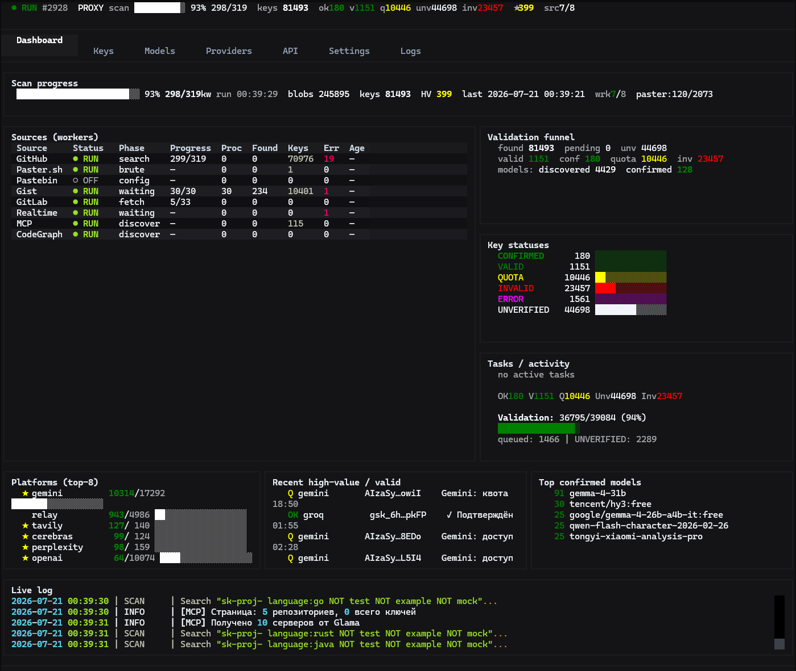
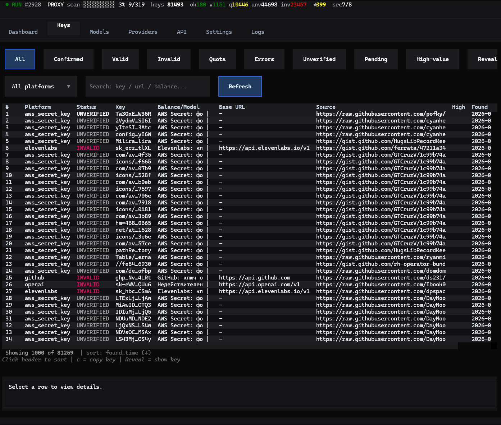
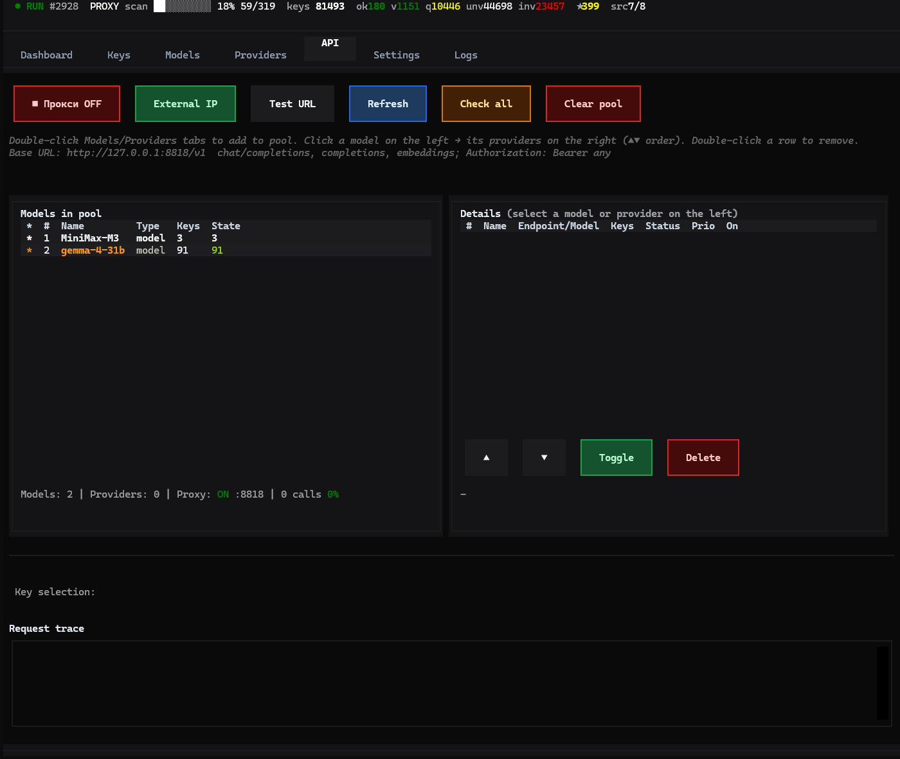

# Secret Scanner Pro

<p align="center">
  <b>Multi-source API key discovery · validation · local OpenAI-compatible proxy</b><br/>
  <sub>Operator Textual TUI · 8 public sources · confirmed model pool on <code>:8818</code></sub>
</p>

<p align="center">
  <!-- Language: same-file anchors (no separate file jump) + dedicated RU page -->
  <a href="#-english"></a>
  <a href="#-русский"></a>
  <a href="./README.ru.md"></a>
</p>

<p align="center">
  
  
  
  
  
</p>

<p align="center">
  
</p>

<details>
<summary><b>Why two language links?</b> GitHub READMEs cannot swap content in-place (no JS). <b>English / Русский</b> badges scroll to sections <i>inside this file</i>. <b>RU full page</b> opens a clean Russian-only README (standard OSS practice).</summary>

| Link | Behavior |
|------|----------|
| **English** / **Русский** badges | Same `README.md` → jump to `#english` / `#русский` |
| **RU full page** | Opens [`README.ru.md`](./README.ru.md) (bookmarks, pure RU) |

</details>

---

<a id="english"></a>
<a id="-english"></a>

## English

### Table of contents

- [About](#about)
- [Features](#features)
- [Demo](#demo)
- [Requirements](#requirements)
- [Quick start](#quick-start)
- [Configuration](#configuration)
- [Usage](#usage)
- [Architecture](#architecture)
- [Tests](#tests)
- [Environment variables](#environment-variables)
- [Disclaimer](#disclaimer)
- [License](#license)
- [Русский](#-русский)

### About

**Secret Scanner Pro** is an operator-grade toolkit that:

1. **Discovers** leaked API keys from **8 public sources**
2. **Validates** them against **30+ platforms** (async pipeline)
3. **Builds** a confirmed model pool (models + endpoints + keys)
4. **Serves** the pool via a local **OpenAI-compatible** HTTP proxy (`http://127.0.0.1:8818/v1`)

Primary UI is a **dark Textual TUI** (`tui_app.py` / `start_tui.bat`). Headless mode writes to `scanner.log` (no legacy Rich Live dashboard).

> **Legal / ethics:** Use only for research, education, and systems you own or are authorized to test. Do not abuse third-party APIs or private data. You are responsible for any credentials stored in `leaked_keys.db`.

### Features

| Area | What you get |
|------|----------------|
| **Sources (11)** | GitHub · Gist · GitLab · Paster.sh · Pastebin · Realtime events · Smithery MCP · SourceGraph CodeGraph · Telegram public channels · HuggingFace code search · Web dorks (Brave/DDG/Google CSE) |
| **Validation** | Async validators, status funnel `pending → valid → confirmed`, high-value flags |
| **Operator TUI** | Dark theme, worker matrix, keys / models / providers / API pool, live log, GitHub-token gate |
| **Local proxy** | `/v1/chat/completions` (+ stream), `/v1/models`, round-robin / sticky key pick |
| **Export** | TXT / CSV / JSON of valid keys, model catalog |
| **Windows** | Double-click `start_tui.bat` / `start_scanner.bat` |

### Demo

Full-width captures of the current Textual TUI (English, wide terminal).  
Do **not** put them in a 3-column table — GitHub shrinks each cell to ~30% width.

#### Dashboard

<p align="center">
  
</p>

#### Keys

<p align="center">
  
</p>

#### API pool

<p align="center">
  
</p>

<details>
<summary>SVG sources (optional)</summary>

Vector captures also live at `assets/tui-dashboard.svg` / `tui-keys.svg` / `tui-api.svg` (post-processed for local mono fonts). README uses PNG so GitHub renders a stable terminal look without CDN font glitches.

</details>

### Language (TUI)

| Mode | How |
|------|-----|
| **Default** | Follows OS locale (`ru*` → Russian, else English) |
| **Settings** | Tab **Settings → Language** (`System` / `English` / `Russian`) + **Apply** |
| **Env** | `TUI_LANG=en` / `ru` / `auto` |
| **config_local.py** | `UI_LANG = "auto"` |

Screenshots below are captured in **English** at a wide terminal size so tables fit.

### Requirements

- **Python 3.11+** (3.12 recommended)
- GitHub **Personal Access Token** (classic, scope `public_repo`) for full GitHub / Gist throughput  
  Other sources still run without it (GitHub path degrades to public-only / 401)
- Optional: network access to Pastebin / Paster / GitLab / Smithery / SourceGraph

### Quick start

```bash
git clone <your-repo-url> Github-API-scan
cd Github-API-scan
pip install -e .        # one command: installs deps + `ascan` launcher
```

Or without install:

```bash
pip install -r requirements.txt
```

#### 1. Add GitHub tokens

Create **`config_local.py`** next to `tui_app.py` (gitignored — never commit secrets):

```text
<project-root>/config_local.py
```

Windows example:

```text
C:\Users\<you>\Github-API-scan\config_local.py
```

```bash
# Windows
copy config_local.py.example config_local.py
# Linux / macOS
cp config_local.py.example config_local.py
```

```python
# config_local.py
GITHUB_TOKENS = [
    "ghp_YOUR_TOKEN_HERE",
]
```

- Create token: [github.com/settings/tokens](https://github.com/settings/tokens)  
- Or env: `set GITHUB_TOKENS=ghp_xxx,ghp_yyy` / `export GITHUB_TOKENS=...`

On TUI start, if **no working** tokens are found, a modal shows this **absolute path** and a copy button.  
Skip check: `TUI_SKIP_TOKEN_CHECK=1`.

#### 2. Run

| How | Command |
|-----|---------|
| **TUI (anywhere)** | `ascan` |
| **Windows TUI** | double-click `start_tui.bat` |
| **Linux/macOS TUI** | `./start_tui.sh` |
| **Windows headless** | double-click `start_scanner.bat` / `ascan --all-sources` |
| **TUI (CLI)** | `python tui_app.py` or `python main_optimized.py` (TUI by default) |
| **Headless all sources** | `python main_optimized.py --all-sources` |
| **Proxy only** | `python proxy_server.py --port 8818` |
| **Upgrade** | `ascan upgrade` (keys/DB untouched) |

### Configuration

| File / var | Purpose |
|------------|---------|
| `config_local.py` | **Secrets** (tokens, optional `PROXY_URL`) — gitignored |
| `config_local.py.example` | Safe template |
| `config.py` | Defaults, platform regexes, dorks |
| `GITHUB_TOKENS` | Env alternative to `config_local.py` |

#### Required credentials

| Var | Needed? | What it buys | Where |
|---|---|---|---|
| `GITHUB_TOKENS` (comma-separated) | **yes** | Code Search + Gist + Realtime: unauthenticated 10 req/min vs 30 req/min **per token**. Keep 4–10 live tokens. | https://github.com/settings/tokens — classic, scope `public_repo` (+ `gist` for gists) |
| `PASTEBIN_API_KEY` | **no** | The Scraping API (`scrape.pastebin.com`) takes **no key** — access is IP-whitelist only (PRO account, static IP). The developer key is for creating pastes, not scraping. | https://pastebin.com/doc_scraping_api |
| `PROXY_URL` | no | Outbound HTTP proxy | — |

GitLab, SourceGraph, MCP (Smithery) and Paster run keyless on public limits. GitLab/SourceGraph tokens are **not** wired into the code yet.

### Usage

#### OpenAI-compatible proxy

```text
Base URL:  http://127.0.0.1:8818/v1
Auth:      Authorization: Bearer <any>   (local; key selection from pool)
```

```bash
curl http://127.0.0.1:8818/v1/models

curl http://127.0.0.1:8818/v1/chat/completions \
  -H "Content-Type: application/json" \
  -d "{\"model\":\"YOUR_MODEL\",\"messages\":[{\"role\":\"user\",\"content\":\"hi\"}]}"
```

Add models / providers from the TUI **API** tab (double-click rows on Models / Providers). Selection mode: **round-robin** or **sticky**.

#### Keyless sources added in 2026-10

| Source | How it works | Measured |
|---|---|---|
| **HuggingFace** | Public full-text index `/api/search/full-text` is queried by key prefixes (`AIzaSy`, `ghp_`, `sk-proj-`, `gsk_`, `fc-`, …); matching `app.py`/dataset files are fetched raw and parsed. The API ignores `offset`, so depth comes from suffix-partitioned queries (each prefix plus one character) with a rotating cursor. | 2 Gemini keys from 12 files on the first cycle |
| **Telegram** | Public channel previews `t.me/s/<channel>` are plain HTML — no account or token. Messages are parsed, deduplicated by id, and key patterns applied. Channels are configurable via `TELEGRAM_CHANNELS`; channels found by the web-dork source are added automatically. | 17 messages parsed, 0 keys in current channel posts |
| **Web dorks** | Operator queries (`site:t.me "AIzaSy"`, …) run through Google Custom Search when `GOOGLE_CSE_KEY`/`GOOGLE_CSE_CX` are set, otherwise through Brave → DuckDuckGo HTML. `t.me/...` hits become Telegram channels for the Telegram source; other pages are fetched and parsed. 429/403 puts the provider on a 30-minute cooldown; the CSE path stops at 90 of the free 100 queries/day. | 6 channels discovered from one dork; bare google.com/search is JS-only and returns no links |

#### Headless scanner

```bash
python main_optimized.py --all-sources
# logs → scanner.log  (operator UI is Textual only)
```

#### Reports, allowlist and DB maintenance

```bash
# machine-readable report for CI (SARIF 2.1.0, keys are always masked)
python main_optimized.py --export-sarif report.sarif

# plaintext exports; add --redact to mask values (sk-pro…UVWX)
python main_optimized.py --export keys.txt --redact
python main_optimized.py --export-csv keys.csv --redact

# suppress a noisy finding (fingerprint column in CSV, or platform:key)
python main_optimized.py --suppress openai:sk-... --reason "docs example"
python main_optimized.py --list-suppressions
python main_optimized.py --unsuppress 0ae94e367bfc1518

# drop pre-gate aws_secret_key garbage (gzip backup -> DELETE -> VACUUM)
python main_optimized.py --purge-junk --purge-dry-run
python main_optimized.py --purge-junk --purge-backup aws_junk.jsonl.gz
```

#### Model lists

`GET /models` is re-read from every provider that has a live key, so the
Models tab and the proxy's `/v1/models` follow reality: new models appear
without re-validating a key, and a model the provider no longer returns is
demoted from "confirmed" on the first miss and deleted after three misses in
a row (a relay that truncates its list cannot wipe working models).

```bash
python main_optimized.py --refresh-models            # all endpoints
python main_optimized.py --refresh-models --models-limit 20
python main_optimized.py --refresh-models --models-base-url https://api.deepseek.com/v1
```

The proxy does the same in the background (first pass 90 s after start, then
hourly with a 6-hour per-endpoint window) and re-syncs `active_pool` every
5 minutes, so key rotation and provider model changes reach `/v1/models`
without a restart. Force it with `POST /admin/refresh-models` (optional body
`{"limit": N, "base_url": "…"}`). The TUI button is *Sync from providers*.

Suppressed findings are excluded from every export (TXT / CSV / SARIF).
Destructive commands (`--reset-db`, `--purge-junk`) ask for confirmation; add `--yes` for non-interactive runs.

### Architecture

```text
┌─────────────────┐     queue      ┌──────────────┐     SQLite
│  source_* (×8)  │ ─────────────► │  validators  │ ──────────► leaked_keys.db
└─────────────────┘                └──────────────┘
        ▲                                 │
        │                          confirmed models
        │                                 ▼
┌─────────────────┐                ┌──────────────┐
│  tui_app.py     │ ◄── stats ───  │ proxy :8818  │ ◄── OpenAI clients
│  (Textual)      │                │ /v1/*        │
└─────────────────┘                └──────────────┘
```

| Module | Role |
|--------|------|
| `tui_app.py` | Operator TUI |
| `main_optimized.py` | Scanner entry (`--all-sources`, exports, stats) |
| `proxy_server.py` | Local OpenAI-compatible gateway |
| `source_*.py` | Per-source workers |
| `validator.py` | Key validation |
| `database.py` | Schema + source telemetry |
| `ui.py` | **Headless** log stub for workers (no Rich Live UI) |

### Tests

```bash
python -m pytest tests/ -q
```

### Environment variables

| Variable | Default | Meaning |
|----------|---------|---------|
| `TUI_AUTOSTART` | `1` | Auto-start scanner from TUI |
| `TUI_AUTODRAIN` | `1` | Background UNVERIFIED drain |
| `TUI_AUTOPROXY` | `1` | Auto-start proxy on `:8818` |
| `TUI_INTERVAL` | `2` | UI tick (seconds) |
| `TUI_SKIP_TOKEN_CHECK` | off | Skip GitHub token modal |
| `TUI_DB` | `leaked_keys.db` | Database filename |
| `SCANNER_ECHO` | off | Echo headless dashboard logs to stderr |

### Disclaimer

This tool finds credentials that were **already exposed** in public places. Operators are responsible for lawful use, rate limits, and securing anything stored in `leaked_keys.db`.

### License

[MIT](LICENSE) © 2025 Secret Scanner Pro

---

<a id="русский"></a>
<a id="-русский"></a>

## 🇷🇺 Русский

<p align="center">
  <a href="#-english"></a>
  <a href="#-русский"></a>
  <a href="./README.ru.md"></a>
</p>

### О проекте

**Secret Scanner Pro** — операторский набор:

1. **Ищет** утёкшие API-ключи в **8 публичных источниках**
2. **Валидирует** на **30+ платформах**
3. **Собирает** пул confirmed-моделей
4. **Отдаёт** через локальный **OpenAI-совместимый** прокси `http://127.0.0.1:8818/v1`

UI: **Textual TUI** (`start_tui.bat` / `python tui_app.py`). Headless пишет в `scanner.log` (старый Rich Live UI удалён).

> **Право / этика:** только исследования, обучение и системы с вашим разрешением.

### Возможности

| Блок | Что даёт |
|------|----------|
| **8 источников** | GitHub · Gist · GitLab · Paster · Pastebin · Realtime · MCP · CodeGraph |
| **Валидация** | Асинхронная воронка статусов, high-value |
| **TUI** | Тёмный дашборд, матрица воркеров, API-пул, модалка токенов |
| **Прокси** | `chat/completions` + stream, sticky / round-robin |
| **Windows** | `start_tui.bat` · `start_scanner.bat` |

### Скриншоты

На всю ширину (не в таблице 3×1 — GitHub сжимает ячейки):

**Дашборд**

<p align="center">
  
</p>

**Ключи**

<p align="center">
  
</p>

**API**

<p align="center">
  
</p>

### Быстрый старт

```bash
git clone <url> Github-API-scan
cd Github-API-scan
python -m venv .venv
.venv\Scripts\activate
pip install -r requirements.txt
copy config_local.py.example config_local.py
# отредактируйте config_local.py → GITHUB_TOKENS = ["ghp_..."]
python tui_app.py
# или: start_tui.bat
```

**Полный путь к токенам** (рядом с `tui_app.py`):

```text
C:\Users\<вы>\Github-API-scan\config_local.py
```

Без рабочих токенов при старте TUI показывается модалка с этим путём.

### Запуск

| Способ | Команда |
|--------|---------|
| TUI (клик) | `start_tui.bat` |
| Headless (клик) | `start_scanner.bat` |
| TUI CLI | `python tui_app.py` |
| Сканер | `python main_optimized.py --all-sources` |
| Прокси | `python proxy_server.py --port 8818` |

### Прокси

```text
http://127.0.0.1:8818/v1
```

### Тесты

```bash
python -m pytest tests/ -q
```

### Лицензия и дисклеймер

- Лицензия: [MIT](LICENSE)
- Инструмент находит данные, **уже** опубликованные в открытом доступе. Ответственность за использование — на операторе.

<p align="right"><a href="#-english">↑ English</a> · <a href="./README.ru.md">Отдельная RU-страница</a></p>
